# 🎯 Guión Maestro: Presentación Ejecutiva a Gerencia (15 Minutos)
## Sistema de Gestión de Mantenimiento — Grupo Macsa CMMS

---

## 📋 Resumen Rápido para la Presentación

* **URL de Presentación:** Servidor de Producción (o `http://localhost:3000` si pruebas local)
* **Usuario Principal:** `ADMIN`  
* **Contraseña:** `ADMIN123`
* **Áreas oficiales registradas:** 30 Áreas de Planta (A001 a A030)
* **Áreas principales para la demo:**
  * **A003:** EMPAQUE - MASTERIZADO (`CC-39`)
  * **A005:** CLASIFICADO (`CC-41`)
* **Activos demostrativos (4 Niveles de Jerarquía):**
  * `A003-001`: Línea Automática de Empaque y Masterizado (Bosch Packaging / Syntegon)
  * `A005-001`: Máquina Clasificadora Óptica Industrial (Bühler Sortex)

---

## ⏱️ Cronómetro Minuto a Minuto (15 Minutos Exactos)

```mermaid
gantt
    title Cronograma de la Presentación (15 Min)
    dateFormat  m
    axisFormat %M min
    section Presentación
    1. Introducción y Dashboard Ejecutivo :0, 2m
    2. Estructura y Árbol de Activos (4 Niveles) :2, 5m
    3. Flujo Completo de OT (Avería -> Cierre) :5, 11m
    4. Mantenimiento Preventivo Programado :11, 13m
    5. Conclusión, KPIs y Beneficios Macsa :13, 15m
```

---

### 🔹 Bloque 1: Introducción y Dashboard Ejecutivo (Minutos 0:00 – 2:00)

**Qué mostrar en pantalla:** Iniciar sesión con `ADMIN` y estar en la pantalla principal (**Dashboard**).

**Qué decir:**
> *"Buenos días / tardes a todos. Hoy les presento el avance del nuevo Sistema Integral de Mantenimiento (CMMS) desarrollado a la medida para Grupo Macsa.*  
> *El objetivo principal de esta plataforma es darnos **visibilidad total en tiempo real** de la salud de nuestros equipos, estandarizar el ciclo de trabajo de mantenimiento y eliminar los paros de planta no planificados mediante control preventivo y trazabilidad de costos."*

**Puntos a señalar en la pantalla:**
1. **Tarjetas de Estado:** OTs abiertas, reportes pendientes y preventivos urgentes.
2. **Indicadores de Confiabilidad:** Disponibilidad operativa y tiempo de respuesta.

---

### 🔹 Bloque 2: Jerarquía y Fichas Técnicas de Activos (Minutos 2:00 – 5:00)

**Qué mostrar en pantalla:** Ir al menú **Activos** ➡️ Seleccionar **Área CLASIFICADO (A005)** ➡️ Abrir `A005-001`.

**Qué decir:**
> *"Para tener un control riguroso, la plataforma estructura los activos de Grupo Macsa en una jerarquía de 4 niveles: **Equipo ➡️ Sub-equipo ➡️ Parte ➡️ Sub-parte**.*  
> *Esto nos permite saber con precisión milimétrica en qué rodamiento, motor o válvula ocurrió una falla o se invirtió presupuesto."*

**Acciones en vivo:**
1. Desplegar el árbol de `A005-001 (Máquina Clasificadora Óptica)`:
   * Mostrar el Sub-equipo `A005-001-03: Banda Transportadora de Clasificación`.
   * Mostrar la Parte `A005-001-03-01: Motorreductor Eléctrico SEW`.
   * Mostrar la Sub-parte `A005-001-03-01-01: Rodamiento Frontal SKF 6308`.
2. Mostrar la **Ficha Técnica**: Señalar los atributos dinámicos (potencia, voltaje, lubricante, capacidad).

---

### 🔹 Bloque 3: El Ciclo de Vida Completo de una Orden de Trabajo (Minutos 5:00 – 11:00) — ⭐ *PLATO FUERTE*

Aquí demuestras cómo viaja la información en la planta desde la falla hasta el cierre.

#### 1. Reporte de Avería (Detección en Planta)
* **Acción:** Ir a **Reportes de Avería** ➡️ Clic en **Nuevo Reporte**.
* **Llenar:**
  * **Activo:** Seleccionar el componente específico `A005-001-03-01-01 (Rodamiento Frontal SKF)`.
  * **Severidad:** `Alta / Crítica`.
  * **Descripción:** *"Se detecta ruido anormal y sobrecalentamiento (72°C) en rodamiento frontal del motorreductor durante turno matutino."*
* **Guardar:** Mostrar la notificación de alerta inmediata que se genera.

#### 2. Generación y Asignación de la Orden de Trabajo (OT)
* **Acción:** En el reporte creado, hacer clic en **Generar Orden de Trabajo** (o ir a Órdenes de Trabajo ➡️ Crear).
* **Llenar:**
  * Se genera automáticamente el código correlativo: `OT-2026-0001`.
  * **Prioridad:** `Alta`.
  * **Tipo de Trabajo:** `Correctivo`.
  * **Responsable:** Asignar a un técnico de mantenimiento.
* **Guardar:** La OT queda en estado `Abierta / Programada`.

#### 3. Ejecución Técnica y Control de Materiales
* **Acción:** Abrir la orden `OT-2026-0001`.
* **Cambiar Estado:** Pasar a **En Proceso**.
* **Registrar Materiales Utilizados:**
  * Repuesto: `Rodamiento SKF 6308-2RS` — Cantidad: `1` — Costo: `$45.00`
  * Lubricante: `Grasa Klüberpaste` — Cantidad: `0.2 Tubo` — Costo: `$15.00`
* **Diagnóstico / Trabajo Realizado:**
  * *"Se realizó desmontaje de tapa frontal, extracción de rodamiento dañado y montaje de nuevo rodamiento SKF con prensa hidráulica y lubricación."*

#### 4. Cierre y Trazabilidad (Kardex)
* **Acción:** Cambiar estado a **Completada / Cerrada**.
* **Qué resaltar:** 
  > *"Al cerrar la orden, el costo de repuestos y las horas de mano de obra se imputan automáticamente al centro de costos `CC-41` (Clasificado). Además, el evento queda registrado de forma inmutable en la bitácora Kardex para fines de auditoría."*

---

### 🔹 Bloque 4: Mantenimiento Preventivo Planificado (Minutos 11:00 – 13:00)

**Qué mostrar en pantalla:** Ir al menú **Mantenimiento Preventivo**.

**Qué decir:**
> *"El verdadero valor del CMMS está en prevenir antes de que las máquinas se detengan. Aquí tenemos el plan maestro `PM-A005-001-MENSUAL`."*

**Acciones en vivo:**
1. Mostrar cómo las actividades preventivas están ligadas a los diferentes componentes del equipo (calibración óptica, revisión de lubricante, pruebas neumáticas).
2. Mostrar el botón de **Generar Orden Preventiva**: con un solo clic se genera la OT preventiva para el equipo completo o por componente.

---

### 🔹 Bloque 5: Conclusión y Beneficios para Gerencia (Minutos 13:00 – 15:00)

**Qué decir (Cierre con impacto):**
> *"En resumen, con la implementación de esta plataforma Grupo Macsa obtiene:*
> 1. ***Cero papeles y tiempos muertos:*** *Toda la comunicación de averías y OTs ocurre en segundos.*
> 2. ***Control estricto de costos de repuestos:*** *Cada tornillo o rodamiento queda asignado al activo y área correspondiente.*
> 3. ***Historial y Auditoría 100% confiable:*** *Sabemos exactamente qué técnico intervino cada máquina, cuándo y por qué.*
> 4. ***Multiplataforma:*** *Accesible desde la web en oficinas y lista para tablets/celulares Android en piso de planta.*
>
> *Quedo a su disposición para cualquier consulta o comentario. Muchas gracias."*

---

## 🛠️ Procedimiento para Preparar la Base de Datos

### En tu PC Local (Para ensayar la presentación):
Ya ejecutamos el script y tu base local está 100% lista.

### En el Servidor de Producción (Antes de la reunión real):
1. Conéctate al servidor por Escritorio Remoto.
2. Abre **SQL Server Management Studio (SSMS)**.
3. Abre el archivo `preparar_demo_gerencia.sql` (lo encuentras en la carpeta `database/` del proyecto).
4. Presiona **F5 (Execute)**.
5. ¡Listo! La base de datos de producción quedará reluciente y limpia con los 2 activos maestros y lista para deslumbrar a gerencia.
