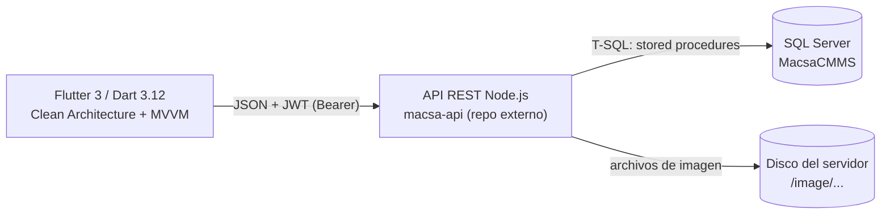

# Sistema CMMS Grupo Macsa

> **Contexto técnico integral del sistema** — frontend Flutter, API REST, base de datos SQL Server, reglas de negocio, operación y estado de la migración.
> Última actualización documental: **2026-11-27**. Versión de la app: **1.0.4+5** (`pubspec.yaml`).

---

## 1. Resumen ejecutivo y stack

Sistema de Gestión de Mantenimiento de Activos para la empresa camaronera **Grupo Macsa**. La aplicación cliente es Flutter (multiplataforma: Web, Windows y Android) y se comunica con una **API REST Node.js** que, a su vez, persiste todo en **SQL Server**.



| Capa | Tecnología | Repositorio / ubicación |
|---|---|---|
| Cliente | Flutter, Dart `^3.12.0`, `provider`, `get_it`, `http`, `pdf`, `printing`, `excel`, `image_picker`, `flutter_local_notifications`, `audioplayers`, `shared_preferences`, `package_info_plus` | Este repositorio, carpeta `lib/` |
| API | Node.js + Express, JWT, PM2 + IIS Reverse Proxy en producción | **Externo**: `C:\Users\user\Documents\macsa-api` |
| Datos | SQL Server (T-SQL), esquema `dbo` | Este repositorio, carpeta `database/` y `scripts/sql_modules/` |

Puntos de verdad (qué archivo manda en cada decisión):

| Decisión | Fuente |
|---|---|
| Comportamiento de la app | `lib/` (especialmente `lib/features/*/data/datasources/`) |
| Contrato HTTP | `lib/core/network/api_endpoints.dart` + `src/routes/*.routes.js` de `macsa-api` |
| Integridad y transacciones | `database/init.sql` y parches cronológicos en `database/` |
| Funcionalidad de usuario | `docs/Manual_Usuario_CMMS_Macsa.docx` y `GUIA_DEMO_GERENCIA_15MIN.md` |
| Despliegue | `REGLAS_PRODUCCION.md` y `database/CHANGELOG.md` |

> **Importante histórico:** el proyecto nació con Firebase Firestore. Esa arquitectura quedó documentada en versiones antiguas de este README y de `AGENTS.md`, pero **ya no está en runtime**: no hay dependencias Firebase, ni `Firebase.initializeApp`, ni `firestore.rules`, ni `firebase_options.dart`, ni `seed_firestore.ps1`, ni listeners `.snapshots()`. Los restos de nomenclatura (`fromFirestore`, `firestoreCollections`, comentarios) se listan en la sección 11.

---

## 2. Mapa del repositorio y módulos

### 2.1 Estructura física

```text
.
├── lib/                      # 258 archivos Dart
│   ├── main.dart             # Arranque
│   ├── app/                  # 19: composición, DI, router, shell, tema, widgets
│   ├── core/                 # 17: red, sesión, seguridad, errores, notificaciones, utils
│   └── features/             # 221: 11 módulos verticales
├── database/                 # 51 scripts .sql + DISENO_BASE_DATOS.md + CHANGELOG.md
├── scripts/
│   ├── sql_modules/          # 7 módulos SQL canónicos (01..07)
│   └── *.js / *.ps1          # 12 utilidades de generación y auditoría SQL
├── tool/                     # hash_password.dart, check_login.dart, sound generator
├── test/                     # 47 archivos *_test.dart
├── docs/                     # Manual de usuario (.docx)
├── android/ ios/ web/ windows/ linux/ macos/   # Scaffolds de plataforma
├── pubspec.yaml
├── REGLAS_PRODUCCION.md
├── GUIA_DEMO_GERENCIA_15MIN.md
└── AGENTS.md
```

### 2.2 Módulos funcionales (`lib/features/`)

Cada módulo sigue **vertical slicing** con tres capas: `domain/` (Dart puro: entidades, contratos y casos de uso), `data/` (datasources REST, modelos JSON, implementaciones de repositorio) y `presentation/` (ViewModels `ChangeNotifier` + Views con `Provider`).

| Módulo | Archivos Dart | Responsabilidad |
|---|---:|---|
| `assets` | 73 | Áreas, jerarquía de activos (CRUD por niveles), búsqueda, serial, traspaso, reactivación, clonado, plantillas, atributos dinámicos, unidades, marcas, reportes PDF/Excel |
| `breakdown_reports` | 23 | Reportes de avería con foto, ciclo de vida, listas (abiertos/míos/todos), alertas y exportación |
| `auth_permissions` | 21 | Login JWT, usuarios, catálogo RBAC, cambio/reset de contraseña, alertas de reset |
| `work_orders` | 21 | Órdenes de trabajo: crear, listar, detalle, estados, alertas, PDF/Excel |
| `operation_reports` | 20 | Disponibilidad operativa, métricas semana/mes, OEE, indicadores de mantenimiento y analítica avanzada |
| `asset_deletion` | 14 | Solicitudes de baja: pedir, listar, aprobar, rechazar |
| `employees` | 13 | Empleados, puestos y su vinculación con usuarios |
| `preventive_schedules` | 12 | Planes preventivos, ejecuciones, estados y generación de OT mensual/masiva |
| `kardex` | 9 | Bitácora inmutable: listado general y por entidad |
| `dashboard` | 8 | Indicadores globales y mantenimientos por centro de costo |
| `app_update` | 7 | Verificación y descarga de versiones Android |

Totales por capa en `features/`: 22 entidades, 13 contratos de repositorio, 60 casos de uso, 15 datasources (14 REST + 1 caché en memoria), 15 modelos, 13 implementaciones de repositorio, 29 ViewModels y 36 vistas/archivos de presentación.

### 2.3 Capa `core/`

| Archivo | Función |
|---|---|
| `network/api_client.dart` | Cliente HTTP: URL base, JWT, multipart, mapeo de errores, resolver de imágenes, logout |
| `network/api_endpoints.dart` | 74 rutas REST centralizadas (38 constantes + 36 builders) |
| `network/session_manager.dart` | Singleton de sesión sobre `SharedPreferences`: `macsa_session_token` / `macsa_session_user`, stream `onSessionExpired` |
| `security/password_hasher.dart` | PBKDF2-HMAC-SHA256 (código heredado; hoy la verificación ocurre en la API) |
| `error/failures.dart` | `ServerFailure`, `CacheFailure`, `ValidationFailure`, `UnauthorizedFailure`, `SerialConflictFailure` |
| `usecases/usecase.dart` | Base `UseCase<T, Params>` y `NoParams` |
| `config/app_version.dart` | Versión en runtime vía `package_info_plus` (fallback `1.0.3+4`) |
| `notifications/*` | Canales Android, cola de Snackbars y sonido local |
| `audio/notification_sound.dart` | Reproduce `assets/audio/notification.wav` |
| `utils/*` | Sanitización, validadores, comparador de versiones, uppercase, guardado de archivos |

---

## 3. Arranque, composición y navegación

### 3.1 Secuencia de arranque (`lib/main.dart`)

```dart
WidgetsFlutterBinding.ensureInitialized();
await AppVersion.initialize();        // package_info_plus
await SessionManager.instance.init(); // restaura JWT + usuario
await configureDependencies();        // GetIt
runApp(const MacsaApp());
```

`MacsaApp` envuelve la app en `MultiProvider(appProviders)` y configura `MaterialApp` con tema Material 3 (azul corporativo `0xFF0055A5`), tema oscuro preparado pero inactivo, `onGenerateRoute` y ruta inicial `/main` si hay token o `/` si no.

### 3.2 Router

`lib/app/router/app_router.dart` usa `Navigator` + `MaterialPageRoute` (no `go_router`):

| Ruta | Destino |
|---|---|
| `/` | `AuthView` (login) |
| `/change-temporary-password` | Cambio obligatorio de contraseña |
| `/main` | `MainShellScreen` |
| `/assets`, `/assets/detail`, `/assets/create`, `/assets/transfer`, `/areas/create` | Módulo de activos |
| `/work-orders` | Lista de órdenes de trabajo |
| `/kardex` | Bitácora (argumento `entityId`) |

Existen `root_screen.dart` y `diagnostic_screen.dart`, actualmente sin cablear al router.

### 3.3 Shell, menú y sesión

`MainShellScreen` organiza **13 secciones** en cuatro grupos del sidebar:

| Grupo | Secciones |
|---|---|
| **OPERACIONES Y CONTROL** | Dashboard, Reportes de operación, Analítica de mantenimiento, Kardex |
| **GESTIÓN DE MANTENIMIENTO** | Activos, Órdenes de trabajo, Preventivo |
| **INCIDENCIAS Y AVERÍAS** | Reportar avería, Mis reportes, Gestión de averías |
| **ADMINISTRACIÓN DEL SISTEMA** | Solicitudes de baja, Empleados, Usuarios |

- Visible para `admin` todo; para el resto se filtra por `AppUser.hasPermission(...)`. Si no hay coincidencia, cae en *Mis reportes*.
- Badges: averías pendientes, reportes propios no leídos, resets de contraseña, preventivos urgentes/vencidos y OTs.
- Las vistas se cachean por sección (`_cachedViews`).
- Política de inactividad: aviso a los **55 min**, cierre forzado a los **60 min**, con chequeo cada 15 s y reacción a `SessionManager.onSessionExpired`.
- Los toques en notificaciones nativas enrutan a averías, OTs, mis reportes o usuarios.

### 3.4 Inyección de dependencias y Providers

- `lib/app/di/get_it.dart`: **133 registros** (122 `registerLazySingleton`, 11 `registerFactory`). Llama a `getIt.reset()` para hot restart. Todo datasource recibe `getIt<ApiClient>()`.
- `lib/app/di/providers.dart`: **18** `ChangeNotifierProvider` globales (update, auth, transfer, plantillas, áreas, atributos, preventivos, OTs, kardex, usuarios, reportes propios, averías, alertas, dashboard, resets, empleados, etc.).
- Regla de oro: **todo use case / repositorio / ViewModel nuevo debe registrarse en `get_it.dart`** o nunca se instanciará.

---

## 4. Contrato de la API REST

### 4.1 Cliente y resolución de URL

`ApiClient` (`package:http`) tiene timeout de **15 s** y añade `Authorization: Bearer <token>` cuando hay sesión. La URL base se resuelve en este orden:

1. `String.fromEnvironment('API_URL')` → `flutter run --dart-define=API_URL=http://...`.
2. Debug Web/Windows: `http://localhost:3000/api`.
3. Debug Android (emulador): `http://10.0.2.2:3000/api`.
4. Release: `http://192.168.1.15:3000/api` (`serverHost` en `api_client.dart`).
5. Fallbacks: host de `Uri.base` en Web, `10.0.2.2` en Android, `localhost`.

> En `REGLAS_PRODUCCION.md` se cita además `https://cmms.macsahn.com/api`; la forma recomendada de usar ese valor hoy es el `--dart-define=API_URL`, sin editar el cliente.

Métodos disponibles: `get`, `post`, `put`, `patch`, `delete` y `postMultipart` (fotos). `resolveImageUrl()` quita el sufijo `/api` para servir rutas `/image/...`. Mapeo de errores:

| HTTP | Resultado en Flutter |
|---|---|
| 2xx | Cuerpo decodificado |
| 401 | `notifySessionExpired()` + `UnauthorizedFailure` |
| 403 / 404 / 409 / 400 / 422 | `ValidationFailure` |
| Otros, timeout o `SocketException` | `ServerFailure` (mensajes en español) |

### 4.2 Catálogo de endpoints

Predefinidos en `lib/core/network/api_endpoints.dart`. La API expone además alias en inglés no todos consumidos por el cliente (`/auth`, `/users`, `/assets`, `/work-orders`, `/breakdown-reports`, etc.).

#### Autenticación, sesión y actualizaciones

| Método | Ruta |
|---|---|
| POST | `/autenticacion/login` |
| GET | `/autenticacion/yo` |
| PUT | `/autenticacion/yo/password` |
| POST | `/autenticacion/logout` *(inline en `ApiClient`)* |
| GET / POST | `/autenticacion/solicitudes-reinicio-password` |
| POST | `/autenticacion/solicitudes-reinicio-password/{id}/resolver` |
| GET | `/app/version-android` |
| GET | `/app/descargar-apk` |
| POST | `/app/version-android` *(solo API)* |

#### Usuarios, áreas y empleados

| Método | Ruta |
|---|---|
| GET / POST | `/usuarios` |
| GET / PUT | `/usuarios/{id}` |
| PATCH | `/usuarios/{id}/deshabilitado` |
| GET / POST | `/areas` |
| PUT / DELETE | `/areas/{areaId}` *(DELETE = baja lógica en SP)* |
| GET / POST | `/empleados` |
| PUT | `/empleados/{id}` |
| POST | `/empleados/{id}/estado` |
| GET / POST | `/empleados/puestos` |
| PUT / DELETE | `/empleados/puestos/{id}` |

#### Activos, plantillas y catálogos

| Método | Ruta |
|---|---|
| GET / POST | `/activos` |
| GET | `/activos/buscar?q=&areaId=&status=` |
| GET | `/activos/serie/{serial}` |
| GET | `/activos/area/{areaId}` |
| GET / PUT | `/activos/{code}` |
| PATCH | `/activos/{code}/estado` |
| POST | `/activos/{code}/traspasar` |
| POST | `/activos/{code}/reactivar` |
| POST | `/activos/{code}/clonar-arbol` |
| POST | `/activos/upload-imagen` *(multipart)* |
| GET / POST | `/plantillas-activos` |
| GET | `/plantillas-activos/{id}` |
| POST | `/plantillas-activos/desde-activo` |
| POST | `/plantillas-activos/{id}/instanciar` |
| DELETE | `/plantillas-activos/{id}` |
| GET | `/catalogos` |
| GET / POST / PUT / DELETE | `/catalogos/unidades[/{id}]` |
| GET / POST / PUT / DELETE | `/catalogos/atributos[/{id}]` |
| GET / POST / PUT / DELETE | `/catalogos/marcas[/{id}]` |

#### Bajas, órdenes de trabajo y averías

| Método | Ruta |
|---|---|
| GET / POST | `/solicitudes-baja` |
| GET | `/solicitudes-baja/pendientes` |
| GET | `/solicitudes-baja/activo/{code}` |
| POST | `/solicitudes-baja/{id}/aprobar` |
| POST | `/solicitudes-baja/{id}/rechazar` |
| GET / POST | `/ordenes-trabajo` |
| GET | `/ordenes-trabajo/abiertas` |
| PUT | `/ordenes-trabajo/{id}` |
| PATCH | `/ordenes-trabajo/{id}/estado` |
| GET / POST | `/reportes-averia` |
| GET | `/reportes-averia/abiertos` |
| GET | `/reportes-averia/mis-reportes` |
| POST | `/reportes-averia/{id}/vincular-orden-trabajo` |
| POST | `/reportes-averia/{id}/resolver` |
| POST | `/reportes-averia/{id}/rechazar` |

#### Preventivos, Kardex, dashboard y operación

| Método | Ruta |
|---|---|
| GET / POST | `/planes-preventivos` |
| GET | `/planes-preventivos/indicadores` *(solo API)* |
| PUT | `/planes-preventivos/{id}` |
| POST | `/planes-preventivos/{id}/ejecuciones` |
| PATCH | `/planes-preventivos/{id}/estado` |
| POST | `/planes-preventivos/{id}/generar-ot-mes` |
| POST | `/planes-preventivos/generar-ots-masivas` *(inline en datasource)* |
| GET / POST | `/kardex` *(POST = append-only)* |
| GET | `/kardex/entidad/{entityId}` |
| GET | `/dashboard/estadisticas` |
| GET | `/dashboard/mantenimientos-centro-costo` |
| GET | `/dashboard/mantenimientos-centro-costo/detalle` |
| POST | `/reportes-operacion` |
| GET | `/reportes-operacion/semana` |
| GET | `/reportes-operacion/equipos` |
| GET | `/reportes-operacion/activo/{code}` |
| GET | `/reportes-operacion/metricas/{code}` |
| PATCH | `/reportes-operacion/equipos/{code}/proceso` |
| GET | `/reportes-operacion/analitica/historial-activo/{code}` |
| GET | `/reportes-operacion/analitica/estacionalidad` |
| GET | `/reportes-operacion/analitica/top-fallas` |
| GET | `/reportes-operacion/analitica/consumo-repuestos` |
| GET | `/reportes-operacion/analitica/oee-general` |

### 4.3 Correlación API → SP

En `macsa-api`, `src/routes/*.routes.js` declara ~130 rutas (con alias) y `src/services/*.service.js` realiza ~103 llamadas `execProc`. Cada endpoint dehydrata/serializa los resultados de los SPs listados en la sección 7. El frontend consume las rutas en español; los alias en inglés son retrocompatibilidad de la API.

---

## 5. Seguridad, sesión y RBAC

### 5.1 Login y contraseñas

- No hay Firebase Auth. El login es `POST /autenticacion/login`; la API verifica **PBKDF2-HMAC-SHA256** (`src/security/password.js`): salt de 16 bytes, hash de 32 bytes, SHA-256, 20.000 iteraciones por defecto y comparación con `crypto.timingSafeEqual`.
- SQL guarda únicamente `PasswordSalt`, `PasswordHash` e `IteracionesPassword` en `dbo.Usuario` (`CK_Usuario_Iteraciones >= 10000`). No existe columna `Password`.
- Bloqueo: **5 intentos fallidos → 15 minutos** (`uspLoginRegistrarFallo`, parche `2026-11-20`); acierto reinicia el contador (`uspLoginReiniciarIntentos`).
- Cambio obligatorio (`DebeCambiarPassword`) redirige a `/change-temporary-password`; el reset genera contraseña temporal hasheada y registra `SolicitudReinicioPassword`.
- `tool/hash_password.dart` replica el algoritmo para sembrar usuarios desde CLI (su comentario aún cita el antiguo `seed_firestore.ps1`).

### 5.2 JWT y sesiones concurrentes

- La API firma JWT con `JWT_SECRET` / `JWT_EXPIRES_IN` del `.env` de `macsa-api` y envía un `jti` con `sessionId = crypto.randomUUID()`.
- `dbo.SesionUsuario` + `uspSesionRegistrar` permiten **máximo 2 sesiones activas por usuario**; al iniciar una tercera se desactivan las más antiguas (FIFO). `uspSesionVerificar` actualiza `UltimaActividad`; `uspSesionCerrar` marca `Activa = 0`.
- Si una sesión fue desplazada, el middleware responde `SESSION_SUPERSEDED`; un `401` en Flutter dispara `SessionManager.notifySessionExpired()` y cierra la sesión local.
- En el cliente, el JWT y el usuario se persisten en `SharedPreferences` bajo `macsa_session_token` y `macsa_session_user`.

### 5.3 RBAC

`AppPermissions` define **22 códigos** `modulo.accion`:

```text
dashboard.view, asset.view, asset.create, asset.edit, asset.transfer,
asset.delete.request, asset.delete.approve, work_order.view, work_order.create,
work_order.execute, work_order.approve, work_order.print, preventive.view,
preventive.manage, kardex.view, breakdown.report, breakdown.view,
breakdown.manage, operation_report.view, operation_report.edit,
employee.manage, user.manage
```

Roles (`UserRole` / `VALID_ROLES` en la API) y cantidad de permisos por defecto:

| Rol | Código | Permisos por defecto | Uso funcional |
|---|---|---:|---|
| Administrador | `admin` | 22 | Acceso total; gestiona usuarios y aprueba bajas |
| Jefe de Mantenimiento | `jefe` | 20 | Operación y aprobación de bajas |
| Jefe de Área | `jefe_area` | 9 | Solicita bajas y gestiona su área |
| Personal de Mantenimiento | `tecnico` | 6 | Ejecuta y valida OTs (rol del parche 2026-11-27) |
| Supervisor (Reportador) | `reportador` | 2 | Reporta averías y consulta sus reportes |
| Gerente (Solo lectura / KPIs) | `lector` | 8 | Dashboard y KPIs |

- `admin` pasa toda verificación por rol o permiso.
- La autorización ejecutable vive en la **API** (`src/security/rolePermissions.js`, middleware `requirePermission` / `requireAnyPermission` / `requireRole`) y en la **UI** (`AuthViewModel.hasPermission`). SQL persiste el catálogo (`Rol`, `Permiso`, `RolPermiso`) y un snapshot efectivo (`UsuarioPermiso`).
- El `HasPermissionUseCase` existe en el dominio pero hoy no está registrado en DI ni usado por el shell.

---

## 6. Modelo de dominio y reglas de negocio

### 6.1 Enums vigentes

| Enum | Valores |
|---|---|
| `AssetLevel` | `equipment`, `subEquipment`, `part`, `subPart` |
| `AssetStatus` | `active`, `transferredDeactivated`, `inactive`, `deleted` |
| `DeletionRequestStatus` | `pending`, `approved`, `rejected` |
| `BreakdownReportStatus` | `reported`, `inWorkOrder`, `resolved`, `rejected` |
| `BreakdownSeverity` | `low`, `medium`, `high` *(la BD también admite `critical`)* |
| `WorkOrderStatus` | `pending`, `inProgress`, `paused`, `reviewPending`, `completed`, `cancelled`, `unfulfilled`, `rescheduled` |
| `WorkOrderPriority` | `low`, `medium`, `high` |
| `ScheduleFrequency` | diaria, semanal, quincenal, mensual, bimestral, trimestral, semestral, anual, bienal |
| `ScheduleStatus` | `active`, `paused`, `completed` |
| `PreventiveAlertLevel` | `overdue`, `urgent` (<48 h), `upcoming` (3–7 d), `onSchedule` |
| `DashboardChartPeriod` | `semana`, `mes`, `ano`, `historico` |

### 6.2 Entidades principales

| Entidad | Campos relevantes |
|---|---|
| `Asset` | `id`, `name`, `brand`, `model`, `areaId`, `stationId`, `parentAssetId`, `level`, `ancestors`, `status`, `transferredToId`, `dynamicAttributes`, `imageData`, `serial`, `observations`, `statusHistory`, `createdAt`, `esEquipoProceso`. El tokenizador de búsqueda genera hasta 10 tokens sin acentos. |
| `Area` | `id`, `name`, `costCenter`, `assetCounter` |
| `AppUser` | `userId`, `username`, `displayName`, `role`, `permissions`, `disabled`, `mustChangePassword`, `passwordResetRequested`, vínculo con empleado |
| `AssetDeleteRequest` | activo/área/estado/motivo, solicitante, decisión, `subtreeCount` |
| `WorkOrder` | correlativo, activo/área, descripción, prioridad, tipos de trabajo, asignación, horas estimadas/reales, materiales, fechas de ejecución, pausas, aprobación, vínculos con avería y preventivo, firmas REG.GMC-MTN-001 |
| `BreakdownReport` | activo/área, descripción, severidad, reportero, foto, estado, OT originada, resolución/rechazo |
| `PreventiveSchedule` | título, activo/área, tipo, frecuencia, materiales, actividades hijas, fechas inicio/próxima/última, estado, auditoría |
| `KardexLog` | `timestamp`, `userId`, `userName`, `action`, `module`, `entityId`, `details` |
| `OperationReport` | horas jornada/operación/paro por causa, `semanaISO`, observaciones, disponibilidad calculada |
| `AppVersionInfo` | versión Android, obligatoria, fecha |

Los 15 modelos en `data/models/` aceptan tanto claves `camelCase` como `PascalCase`/español (`CodigoActivo`, `codigoActivo`, `assetCode`, `Id`, …) para tolerar la transición desde Firestore.

### 6.3 Jerarquía e IDs

- Áreas: `A001` … `A030`, con contador global `dbo.Contador['areas']` (semilla `31`).
- Equipos raíz: `{área}-00N`, usando `dbo.Area.ContadorActivos` con `UPDLOCK, HOLDLOCK`.
- Hijos: `{padre}-NN`, usando `dbo.Activo.ContadorHijos`.
- `RutaAncestros` es la ruta materializada (equivalente al antiguo `ancestors`). Nivel derivado de la profundidad: equipo → sub-equipo → parte → sub-parte.
- No se crean hijos bajo un padre que no esté `active`.
- Serial único global para equipos; se valida contra activos no eliminados (tras un traspaso conviven original desactivado y copia activa).

### 6.4 Flujos implementados

**Transferencia** (`/activos/{code}/traspasar`): solo equipos `active` a un área distinta. En una sola transacción valida `CandadoBaja`, desactiva el origen (`transferredDeactivated`, `TraspasadoACodigo`), duplica el subárbol con nuevos IDs (BFS determinístico) y escribe el evento en Kardex.

**Reactivación** (`/activos/{code}/reactivar`): solo para activos `transferredDeactivated`; restaura el subárbol completo dentro de la transacción.

**Baja con aprobación** (`asset_deletion`): el jefe solicita con motivo (`asset.delete.request`); el administrador/jefe aprueba o rechaza (`asset.delete.approve`). Al aprobar, el activo y todo su subárbol pasan a `deleted` (baja lógica). `CandadoBaja` con `UPDLOCK, HOLDLOCK` impide solicitudes duplicadas, dobles resoluciones y operaciones sobre activos con baja pendiente. Eventos: `ASSET_DELETE_REQUESTED`, `ASSET_DELETED`, `ASSET_DELETE_REJECTED`.

**Kardex append-only**: toda alta, edición, traspaso, reactivación, baja, creación de OT, resolución de avería, ejecución preventiva, cambio de estado y alta de empleado escriben su evento en `BitacoraKardex` dentro de la misma transacción. Un trigger impide `UPDATE`/`DELETE`.

**Órdenes de trabajo**: correlativo `OT-{año}-{NNNN}` desde `dbo.Contador['work_orders']`, sin reinicio anual. Existe validación de OT abierta previa por activo. El parche `2026-11-27` añade pausas con cronómetro (`FechaInicioReal`, `FechaFinReal`, `MinutosPausaAcumulados`, `MotivoPausa`) y aprobación (`reviewPending` → `AprobadoPor...`). Materiales e imputación a centro de costo al cerrar.

**Averías → OT**: reporte con foto opcional, estados `reported`/`inWorkOrder`/`resolved`/`rejected`, vinculación bidireccional con la OT y control anti-duplicados.

**Preventivos**: planes por activo o transversales, frecuencias amplias, ejecuciones con fechas, alertas de urgencia y generación de OT mensual o masiva. Al dar de baja un activo se pausan sus planes.

**Disponibilidad y OEE**: `ReporteOperacionDiaria` con horas de jornada, operación y paros por causa; métricas de disponibilidad, MTBF/MTTR, estacionalidad, top fallas, consumo de repuestos y OEE general; marcar equipos como "de proceso" para analítica.

**Plantillas y catálogos**: guardar un árbol de activos como plantilla, instanciarlo en otra área, clonar árbol, atributos dinámicos con unidades de medida, marcas y puestos de empleados.

**Notificaciones y actualizaciones**: no hay listeners en tiempo real; los ViewModels hacen polling (averías, mis reportes y OTs cada 10 s; resets cada 15 s; versión Android cada 30 s solo en Android) y usan notificaciones locales. La app también descarga e instala APKs desde el propio cliente.

---

## 7. Base de datos SQL Server

### 7.1 Fuente ejecutable

`database/init.sql`, generado el **2026-11-13** desde `scripts/sql_modules/01..07`, crea `MacsaCMMS` si no existe (compatibilidad 150), define 29 tablas `dbo.*`, 104 procedimientos, TVPs, funciones, índices, checks, un trigger, `GRANT`s y seed. Es un **baseline destructivo** (`DROP TABLE IF EXISTS` / `DROP PROCEDURE IF EXISTS`), no un script incremental.

TVPs: `TipoListaTexto`, `TipoMaterialOrdenTrabajo`, `TipoMaterialPreventivo`, `StringListType`, `WorkOrderMaterialType`, `PreventiveMaterialType`.
Funciones: `fnFrecuenciaDias`, `fnFrecuenciaEtiqueta`, `fnFrequencyDays`, `fnFrequencyLabel`.

### 7.2 Tablas (29)

| Dominio | Tablas |
|---|---|
| Catálogos base | `Rol`, `Permiso`, `RolPermiso`, `Contador`, `Area`, `Puesto`, `UnidadMedida`, `AtributoCatalogo`, `Marca` |
| Usuarios y sesión | `Usuario`, `UsuarioPermiso`, `SolicitudReinicioPassword`, `SesionUsuario` |
| Empleados | `Empleado` (FK a `Puesto` y `Area`) |
| Activos | `Activo`, `HistorialEstadoActivo`, `CandadoBaja`, `SolicitudBaja` |
| Plantillas | `PlantillaActivo`, `PlantillaActivoNodo` |
| Averías y OTs | `ReporteAveria`, `OrdenTrabajo`, `MaterialOrdenTrabajo`, `TipoTrabajoOrdenTrabajo` |
| Preventivos | `PlanPreventivo`, `MaterialPreventivo` |
| Operación y analítica | `ReporteOperacionDiaria` |
| Auditoría y updates | `BitacoraKardex`, `ActualizacionesAndroid` |

Restricciones destacadas:

- `Activo`: PK natural `CodigoActivo`; CHECK de `Nivel` y `Estado`; `TextoBusqueda` columna calculada persistida para búsqueda AND con `LIKE`; `Serie` con índice filtrado por `Estado <> 'deleted'`; `VersionFila ROWVERSION`.
- `Usuario`: `UQ_Usuario_NombreUsuario`, flags de bloqueo/cambio/reset y `CK_Usuario_Iteraciones >= 10000`.
- `CandadoBaja`: PK `CodigoActivo`, `EstadoCandado` en `pending/approved/rejected`.
- `SolicitudBaja`: estados `pending/approved/rejected`, índice `(Estado, SolicitadoEn)`, `VersionFila`.
- `ReporteAveria`: severidad `low/medium/high/critical`, `ImagenUrl`, FKs a activo, usuario y OT.
- `OrdenTrabajo`: 8 estados (parche 11-27), prioridad, descripción no vacía, FKs, `VersionFila`.
- `ReporteOperacionDiaria`: `UQ_ROD_Activo_Fecha(CodigoActivo, FechaOperacion)`.
- `BitacoraKardex`: `CK_BK_Modulo` con `ASSETS`, `WORK_ORDERS`, `BREAKDOWNS`, `PREVENTIVE`, `PREVENTIVE_SCHEDULES`, `AREAS`, `OPERATION_REPORTS`, `USERS`, `EMPLOYEES`, `POSITIONS`; trigger `TR_BitacoraKardex_SoloInsercion` (`FOR UPDATE, DELETE`) que hace `RAISERROR` + `ROLLBACK`.

El trigger de inmutabilidad `trActivo_Inmutable` (protege `AreaId`, `Nivel`, `RutaAncestros`, `CodigoActivoPadre`, `Serie`, `EsEquipoProceso`) vive hoy en `fix_disponibilidad_sql.sql`, **no en `init.sql`**.

### 7.3 Catálogo de stored procedures

Agrupados por dominio (definiciones en `init.sql`, con overrides en los parches):

**Autenticación, sesión y usuarios**

```text
uspUsuarioObtenerParaLogin      uspLoginRegistrarFallo          uspLoginReiniciarIntentos
uspLoginMigrarHash              uspSesionRegistrar              uspSesionVerificar
uspSesionCerrar                 uspUsuarioCrear                 uspUsuarioActualizar
uspUsuarioAlternarDeshabilitado uspUsuarioCambiarPassword       uspUsuarioReiniciarTemporal
uspSolicitudReinicioPasswordCrear        uspSolicitudReinicioPasswordListarPendientes
uspSolicitudReinicioPasswordMarcarResuelta
uspUsuarioObtenerTodos          uspUsuarioObtenerPorId
```

**Catálogos dinámicos**

```text
uspCatalogosObtener
uspUnidadMedidaListar / Crear / Actualizar / Eliminar
uspAtributoCatalogoListar / Crear / Actualizar / Eliminar
uspMarcaListar / Crear / Actualizar / Eliminar
```

**Áreas, puestos y empleados**

```text
uspAreaObtenerTodas / Crear / Actualizar / Eliminar
uspPuestoListar / Crear / Actualizar / Eliminar
uspEmpleadoListar / Crear / Actualizar / CambiarEstado
```

**Activos, jerarquía, plantillas y traspaso**

```text
uspActivoObtenerRaicesPorArea   uspActivoObtenerHijos           uspActivoBuscar
uspActivoBuscarPorSerie         uspActivoCrear                  uspActivoActualizar
uspActivoTraspasar              uspActivoReactivar              uspActivoAlternarEstado
uspActivoActualizarEsEquipoProceso                              uspActivoClonarArbol
uspPlantillaActivoListar        uspPlantillaActivoObtenerDetalle
uspPlantillaActivoGuardarDesdeActivo                            uspPlantillaActivoInstanciar
uspPlantillaActivoEliminar
```

**Bajas con aprobación**

```text
uspSolicitudBajaCrear           uspSolicitudBajaObtenerPendientes
uspSolicitudBajaObtenerTodas    uspSolicitudBajaObtenerPendientePorActivo
uspSolicitudBajaAprobar         uspSolicitudBajaRechazar
```

**Averías**

```text
uspReporteAveriaCrear           uspReporteAveriaObtenerTodos
uspReporteAveriaObtenerPorUsuario                              uspReporteAveriaObtenerAbiertos
uspReporteAveriaVincularOrdenTrabajo                           uspReporteAveriaResolver
uspReporteAveriaRechazar
```

**Órdenes de trabajo**

```text
uspOrdenTrabajoObtenerTodas     uspOrdenTrabajoObtenerAbiertas  uspOrdenTrabajoCrear
uspOrdenTrabajoActualizarEstado                                uspOrdenTrabajoActualizarDetalles
```

**Preventivos**

```text
uspPlanPreventivoObtenerTodos   uspPlanPreventivoCrear          uspPlanPreventivoModificar
uspPlanPreventivoRegistrarEjecucion                            uspPlanPreventivoAlternarEstado
uspPlanPreventivoObtenerIndicadores
uspGenerarOrdenTrabajoPreventiva          uspGenerarOrdenesTrabajoPreventivasVencidas
uspGenerarOrdenTrabajoPreventivaMes       uspGenerarOrdenesTrabajoPreventivasMasivas
```

**Operación, OEE y analítica**

```text
uspReporteOperacionRegistrar    uspReporteOperacionObtenerPorActivo
uspReporteOperacionObtenerPorSemana                            uspReporteOperacionMetricas
uspEquipoProcesoListarPorArea   uspReporteHistorialActivo       uspReporteEstacionalidadAverias
uspReporteTopEquiposFallas      uspReporteConsumoRepuestos      uspReporteOEEGeneral
```

**Kardex, dashboard y actualizaciones Android**

```text
uspKardexAgregar                uspKardexObtenerTodos           uspKardexObtenerPorEntidad
uspDashboardObtenerEstadisticas                                uspReporteMantenimientosPorCentroCosto
uspReporteMantenimientosPorCentroCostoDetalle
uspActualizacionAndroidObtener  uspActualizacionAndroidRegistrar
uspActualizacionAndroidObtenerUltima
```

Overrides por parche:

- `2026-11-20`: `uspLoginRegistrarFallo`, `uspSesionRegistrar`, `uspSesionVerificar`, `uspSesionCerrar`.
- `2026-11-24`: `uspReporteOperacionRegistrar`, `uspReporteOperacionMetricas`, `uspReporteOperacionObtenerPorSemana`, `uspEquipoProcesoListarPorArea`.
- `2026-11-27`: `uspOrdenTrabajoActualizarEstado`, `uspOrdenTrabajoObtenerTodas`, `uspOrdenTrabajoObtenerAbiertas`. El encabezado también anuncia `uspOrdenTrabajoActualizarDetalles`, pero el cuerpo del parche no lo redefine (ver sección 11).

### 7.4 Atomicidad y bloqueos

Patrón dominante:

```sql
SET XACT_ABORT ON;
BEGIN TRY
    BEGIN TRANSACTION;
    ...
    COMMIT TRANSACTION;
END TRY
BEGIN CATCH
    IF @@TRANCOUNT > 0 ROLLBACK TRANSACTION;
    THROW;
END CATCH;
```

`UPDLOCK, HOLDLOCK` aparece en `uspActivoCrear` (contadores de área/hijos), `uspOrdenTrabajoCrear` (sincronización de `dbo.Contador` contra correlativos existentes), `uspSolicitudBajaAprobar`, `uspReporteAveriaCrear`, `uspActivoTraspasar`, SPs de puestos/empleados y operaciones OEE con `MERGE`. La baja lógica sustituye cualquier `DELETE` físico de negocio.

Permisos de BD: `init.sql` crea el usuario `macsa_app` y le da `EXECUTE` sobre `dbo` **y también** `SELECT, INSERT, UPDATE, DELETE` en todo el esquema (el blueprint pedía solo `EXEC`; la integración se apoya en el trigger de Kardex).

---

## 8. Migraciones y despliegue

### 8.1 Cronología real

`database/CHANGELOG.md` solo registra hasta 2026-10-20; la secuencia efectiva según los archivos existentes es:

| Fecha | Script | Cambio |
|---|---|---|
| 2026-09-28 | `init.sql`, `crear_usuario_admin.sql` + migraciones iniciales | Estructura base, usuario `ADMIN`, roles/permisos |
| 2026-10-20 | `2026-10-20_blindaje_ot_abierta_activo.sql` | Rechaza crear OT si el activo tiene otra abierta |
| 2026-10-29 | `2026-10-29_reporteria_analitica_mantenimiento_oee.sql` | Columnas OEE en `ReporteOperacionDiaria` |
| 2026-11-06 | `2026-11-06_modulo_empleados.sql`, `2026-11-06_blindaje_baja_y_traspaso_activos.sql` | Empleados; bloquea bajas/traspasos con OTs abiertas y pausa preventivos al dar de baja |
| 2026-11-09 | `2026-11-09_foto_reporte_averia.sql` | `ReporteAveria.ImagenUrl` y foto visible desde OT |
| 2026-11-11 | `2026-11-11_catalogo_puestos.sql`, `..._rbac_y_vinculo_empleados.sql`, `..._fix_kardex_modulo_employees.sql`, `..._fix_mojibake_utf8.sql` | Puestos, RBAC, `Usuario.EmpleadoId`, módulos de Kardex, reparación UTF-8 |
| 2026-11-12 | `2026-11-12_normalizacion_y_escalabilidad.sql` | `Empleado.PuestoId`, índices, paginación `@Limit/@Offset`, `uspCatalogosObtener` |
| 2026-11-13 | `deploy_produccion_2026-11-13.sql`, `patch_...hotfix_procs.sql`, `init.sql` regenerado | Bundle de producción y consolidado desde `scripts/sql_modules/` |
| 2026-11-14 | `patch_2026-11-14_activos_fix.sql`, `patch_..._empleados_usuarios_actualizaciones.sql` | Correcciones de activos y empleados/usuarios |
| 2026-11-15 | `patch_2026-11-15_atributos_y_unidades.sql` | `UnidadMedida`, `AtributoCatalogo` |
| 2026-11-16 | `patch_2026-11-16_clonar_activos_plantillas_observaciones.sql` | `Observaciones`, plantillas y `uspActivoClonarArbol` |
| 2026-11-17 | `patch_2026-11-17_fixes_estado_ot.sql`, `..._marcas_y_mantenimientos_centro_costo.sql`, `..._traspaso_collate_y_serie_editable.sql` | Marcas, centro de costo, collation y serie editable |
| 2026-11-18 | `update_produccion_2026-11-18.sql` | Bundle idempotente de 11-15/16/17 |
| 2026-11-20 | `patch_2026-11-20_seguridad_sesiones_y_bloqueo.sql` | `SesionUsuario`, bloqueo 5 → 15 min |
| 2026-11-24 | `patch_2026-11-24_disponibilidad_y_reportes_operacion.sql` | Fix 500 al guardar reporte, disponibilidad/MTBF/MTTR, reporte semanal |
| 2026-11-27 | `patch_2026-11-27_flujo_ordenes_trabajo_y_tecnico.sql` | Rol `tecnico`, `work_order.execute`/`approve`, cronómetro y aprobación de OTs (**sin commitear al escribir este README**) |

### 8.2 Fuentes modulares y builders

`scripts/sql_modules/01_tables.sql` … `07_seed_data.sql` son la fuente usada por los builders de `scripts/`:

- `build_clean_production_sql.js` concatena los 7 módulos y **sobrescribe** `database/deploy_produccion_2026-11-13.sql` y `database/init.sql`.
- `build_consolidated_production_update.js` produce `update_produccion_2026-11-18.sql`.
- `build_clean_hotfix_patch.js`, `build_hotfix_patch.js`, `generate_all_hotfixes.js`, `apply_final_sp_corrections.js`, `fix_all_sp_syntax.js`, `fix_clean_final.js`, `update_sp03.js`: generación y reparación de parches.
- `audit_sp_parameters.js` e `inspect_procs.js`: cruzan `execProc` de `macsa-api` con los parámetros de los SPs.
- `build_user_manual.ps1`: genera el manual de usuario.

> No regenerar `init.sql` sin revisar antes los parches posteriores: el consolidado no incluye cambios del 15/16/17/20/24/27.

### 8.3 Entornos y reglas de producción

Resumen de `REGLAS_PRODUCCION.md` (revisión 2026-10-03):

| Aspecto | Desarrollo | Producción |
|---|---|---|
| SO | Windows 11 | Windows Server 2019 Standard |
| SQL Server | Local (`MacsaCMMS_DEV`) | Instancia compartida, puerto `50566`, BD `MacsaCMMS` / `bdMacsaCMMS` |
| API | `npm run dev`, puerto 3000 | PM2 + IIS Reverse Proxy (`C:\inetpub\wwwroot\APIs\macsa-api\`) |
| Web | `flutter run -d chrome` | Estático en `C:\inetpub\wwwroot\macsa-web\` |
| APK | Debug en emulador/dispositivo | Release en `files/apk/` |
| API URL cliente | `http://localhost:3000/api` | `--dart-define=API_URL=...` (o IP `192.168.1.15`) |

Variables `.env` de `macsa-api` (archivo externo, **no incluido en este repo**): `NODE_ENV`, `PORT`, `DB_SERVER`, `DB_PORT`, `DB_DATABASE`, `DB_USER`, `DB_PASSWORD`, `DB_ENCRYPT`, `DB_TRUST_SERVER_CERTIFICATE`, `DB_POOL_MAX`, `JWT_SECRET`, `JWT_EXPIRES_IN`, `CORS_ORIGIN`.

Reglas de oro: nunca desarrollar contra producción; toda migración es un script **nuevo**, idempotente y fechado en `database/`, probado primero en DEV y registrado en `CHANGELOG.md`; backup obligatorio antes de desplegar; no editar scripts ya ejecutados; verificar el `USE [BD]`; `flutter analyze && flutter test` antes de buildear; PM2 (`pm2 logs macsa-api`), IIS sin `iisreset` innecesario; no subir `.env` (el `.gitignore` actual **no** lo excluye).

---

## 9. Operación, demo y documentación funcional

### 9.1 Credenciales y datos de demostración

| Uso | Usuario | Contraseña | Notas |
|---|---|---|---|
| Demo gerencia | `ADMIN` | `ADMIN123` | Rol `admin`; ver `GUIA_DEMO_GERENCIA_15MIN.md` |
| Seed SQL | `NMENDEZ` | `ADMIN123` | Empleado Nixon Méndez, rol `admin` |
| Demo jefe | `JEFE` | `ADMIN123` | Creado por `database/preparar_demo_gerencia.sql` |

> Credenciales de **demostración / desarrollo**. No usar en producción; la API las verifica con PBKDF2 y la contraseña nunca se guarda en claro.

Datos demo: 30 áreas oficiales `A001`–`A030`; áreas destacadas `A003` EMPAQUE-MASTERIZADO (`CC-39`) y `A005` CLASIFICADO (`CC-41`); activos `A003-001` (línea Bosch/Syntegon) y `A005-001` (clasificadora óptica Bühler Sortex) con jerarquía de 4 niveles (`A005-001-03` → `-03-01` → `-03-01-01`).

Preparación: ejecutar `database/preparar_demo_gerencia.sql` (F5 en SSMS) sobre la BD de demo. También existen `seed_activo_clasificado_jerarquia.sql`, `seed_activo_empaque_masterizado.sql` y `seed_activos_ejemplo.sql`.

### 9.2 Guion de demo (15 minutos)

1. **0–2 min** — Login `ADMIN`, dashboard con OTs abiertas, reportes pendientes, preventivos urgentes, disponibilidad y tiempo de respuesta.
2. **2–5 min** — Activos: área `A005`, árbol `A005-001` → sub-equipo → parte → sub-parte, ficha con atributos dinámicos.
3. **5–11 min** — Ciclo OT: reportar avería (severidad alta, foto) → generar OT `OT-2026-0001` con técnico → `En Proceso` → materiales y costos → `Completada`, imputación a `CC-41` y evento en Kardex.
4. **11–13 min** — Preventivo `PM-A005-001-MENSUAL`: actividades por componente y generación de OT.
5. **13–15 min** — Cierre: KPIs, auditoría, control de costos y multiplataforma.

### 9.3 Manual de usuario

`docs/Manual_Usuario_CMMS_Macsa.docx` (v1.0, septiembre 2026, Nixon Méndez) describe para los perfiles `jefe`, `reportador` y `lector`: acceso, menú lateral, consulta de activos y exportación PDF/Excel, OTs con seguimiento por porcentaje e impresión, planes preventivos individuales y por lote, disponibilidad/OEE, reporte de averías, mis reportes, gestión de averías, Kardex de solo lectura, FAQ y glosario. Requisitos de uso: Chrome/Edge, Windows, red interna, 1366×768. No incluye credenciales (las entrega el administrador).

---

## 10. Comandos

```bash
# Dependencias y verificación
flutter pub get
flutter analyze                 # ver §11: errores preexistentes en el flujo OT sin commitear
flutter test                    # 47 archivos de test, ~208 casos declarados
flutter test test/features/assets/data/models/asset_model_test.dart
flutter test --name "transfer"

# Ejecución
flutter run -d chrome
flutter run -d windows
flutter run -d chrome --dart-define=API_URL=http://localhost:3000/api

# Builds
flutter build apk
flutter build web

# Utilidades
dart run tool/hash_password.dart
dart run tool/check_login.dart
```

Base de datos y despliegue:

```powershell
# Aplicar migraciones incrementalmente en DEV antes que en PROD (ver sección 8)
# Registrar cada ejecución en database/CHANGELOG.md

# Generar bundles desde módulos (¡sobrescribe init.sql!)
node scripts/build_clean_production_sql.js
node scripts/build_consolidated_production_update.js
node scripts/audit_sp_parameters.js
```

No hay comandos `firebase`, `flutterfire` ni `firebase deploy` vigentes.

---

## 11. Estado de la migración y deuda técnica

Situación a 2026-11-27: **la migración a SQL Server está funcionalmente integrada**, con un flujo de OTs en curso. Puntos a vigilar:

1. **Documentación heredada**: `README.md` y `AGENTS.md` describieron Firestore hasta esta actualización; `database/DISENO_BASE_DATOS.md` sigue siendo un blueprint con nombres en inglés (`dbo.Asset`, `uspAssetCreate`), bloqueo de 5 min y `DENY UPDATE/DELETE` para Kardex, mientras la implementación usa nombres en español, 15 min y trigger.
2. **`CHANGELOG.md` desactualizado**: se detiene en 2026-10-20; faltan 10-29 y todos los parches 11-06 a 11-27.
3. **Residuos Firestore en código**: constante `AppConstants.firestoreCollections`, alias `fromFirestore` / `toFirestore` en 8 modelos y dos comentarios en `asset_form_view.dart` y `asset_create_edit_viewmodel.dart`. No ejecutan nada.
4. **`init.sql` no re-ejecutable tal cual** sobre una BD con tablas nuevas: su lista de `DROP TABLE` omite `SesionUsuario`, `UnidadMedida`, `AtributoCatalogo`, `Marca`, `PlantillaActivo` y `PlantillaActivoNodo`; además tiene SPs que dependen del parche 10-29 y un `DROP PROCEDURE` de `uspEquipoProcesoListarPorArea` cuya definición vive en el parche 11-24. `trActivo_Inmutable` solo está en `fix_disponibilidad_sql.sql`.
5. **Cambio sin commitear**: `patch_2026-11-27_flujo_ordenes_trabajo_y_tecnico.sql` y 13 archivos Dart/SQL modificados (rol `tecnico`, 8 estados de OT, pausas y aprobación). El encabezado del parche anuncia `uspOrdenTrabajoActualizarDetalles`, pero el cuerpo no lo redefine. `flutter analyze` (2026-11-27) reporta errores de compilación en este trabajo en curso (`work_order_detail_view.dart` y `work_order_report_pdf_builder.dart`); no proceden de la documentación.
6. **RBAC**: la API y el cliente tienen 6 roles / 22 permisos; `init.sql` sembró 5 roles / 20 permisos y el parche 11-27 añade el resto. `HasPermissionUseCase` no está registrado en DI.
7. **Caché local**: `AssetLocalDataSource` es un `Map` en memoria por área; se escribe pero el repositorio no lo lee. El cálculo del siguiente ID de activo se hace en cliente, no vía SP de contador.
8. **Versionado**: `pubspec.yaml` dice `1.0.4+5`, pero `AppVersion` tiene fallback `1.0.3+4` corregido en runtime con `package_info_plus`.
9. **Secretos**: `.gitignore` no excluye `.env`; las reglas de producción exigen no versionarlo. Las credenciales de este README son solo de demo.
10. **Pruebas**: los documents históricos citan «49 pruebas» y `AGENTS.md` citaba 128; el inventario actual es de 47 archivos y 208 llamadas `test()`/`testWidgets()` (no ejecutadas durante esta actualización documental). Sin tests dedicados para `employees`, `kardex`, `operation_reports` ni la navegación del shell.

---

## 12. Documentos relacionados

| Documento | Para qué sirve |
|---|---|
| `AGENTS.md` | Reglas de trabajo para agentes: arquitectura, DI, comandos y gotchas |
| `REGLAS_PRODUCCION.md` | Entornos, `.env`, migraciones, deploy PM2/IIS, checklist y troubleshooting |
| `database/DISENO_BASE_DATOS.md` | Blueprint conceptual Firestore → T-SQL (referencia histórica, no estado final) |
| `database/CHANGELOG.md` | Registro de migraciones aplicadas (desactualizado; ver sección 8) |
| `GUIA_DEMO_GERENCIA_15MIN.md` | Guion ejecutivo de demostración y datos de ejemplo |
| `docs/Manual_Usuario_CMMS_Macsa.docx` | Manual funcional por rol y flujos de usuario |
| `C:\Users\user\Documents\macsa-api` | Código de la API REST (externo a este repo) |
