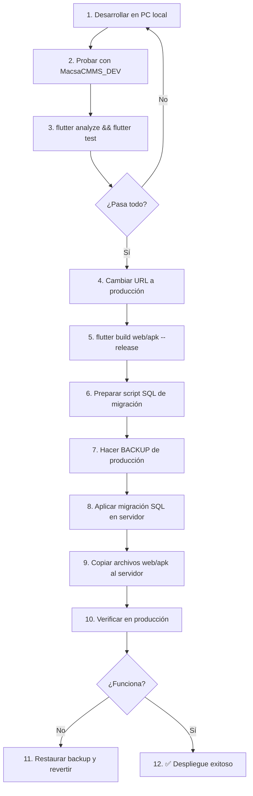

# 🏭 Reglas y Procedimientos de Producción — Macsa CMMS

**Documento vivo** — Actualizar cada vez que cambie la arquitectura o la infraestructura.  
**Última revisión:** 2026-10-03

---

## 1. Entornos y Arquitectura

El sistema opera en **dos entornos** completamente aislados:

| Aspecto | 🖥️ Desarrollo (tu PC) | 🏭 Producción (Servidor empresa) |
| :--- | :--- | :--- |
| **SO** | Windows 11 | Windows Server 2019 Standard |
| **SQL Server** | Local (puede ser Express o Developer) | Instancia compartida, puerto `50566` |
| **Base de datos** | `MacsaCMMS_DEV` *(copia de producción)* | `MacsaCMMS` (o `bdMacsaCMMS`) |
| **API Node.js** | `npm run dev` (puerto 3000 local) | PM2 + IIS Reverse Proxy |
| **Flutter Web** | `flutter run -d chrome` | Build estático en IIS |
| **Flutter APK** | Depuración en emulador/dispositivo | Build release en `files/apk/` |
| **URL API (Flutter)** | `http://localhost:3000/api` | `https://cmms.macsahn.com/api` (o IP actual) |

> [!CAUTION]
> **NUNCA desarrolles ni pruebes directamente contra la base de datos de producción.** Siempre trabaja contra tu copia local.

---

## 2. Configuración de Entorno Local para Desarrollo

### 2.1 Archivo `.env` de la API — Entorno de Desarrollo

En tu PC, el archivo `.env` de `macsa-api` debe apuntar a tu SQL Server local:

```ini
NODE_ENV=development
PORT=3000

DB_SERVER=localhost
DB_PORT=1433
DB_DATABASE=MacsaCMMS_DEV
DB_USER=sa
DB_PASSWORD=TuPasswordLocal
DB_ENCRYPT=false
DB_TRUST_SERVER_CERTIFICATE=true
DB_POOL_MAX=10

JWT_SECRET=dev_secret_key_no_usar_en_produccion
JWT_EXPIRES_IN=8h

CORS_ORIGIN=*
```

### 2.2 Archivo `api_client.dart` — Entorno de Desarrollo

Para desarrollar y probar en tu PC, el archivo `lib/core/network/api_client.dart` debe quedar así:

```dart
static String get defaultBaseUrl {
  if (kIsWeb) return '/api';
  return 'http://localhost:3000/api'; // ← Desarrollo local
}
```

> [!IMPORTANT]
> **Antes de hacer un build de producción (web o apk)**, SIEMPRE cambia la URL a la de producción:
> ```dart
> return 'http://<IP_O_DOMINIO_PRODUCCION>/api'; // ← Producción
> ```

### 2.3 Base de Datos Local (Copia de Desarrollo)

Mantén una copia **idéntica en estructura** a la de producción:

1. **Crear la copia inicial:** Solicita un backup `.bak` de producción (o genera el script con *Generate Scripts → Schema and Data*), y restáuralo en tu SQL Server local con el nombre `MacsaCMMS_DEV`.
2. **Sincronizar periódicamente:** Cada vez que necesites datos frescos de producción, solicita un nuevo backup.
3. **NUNCA uses datos sensibles reales en desarrollo.** Si necesitas probar con datos de usuarios, anonimiza contraseñas y nombres.

---

## 3. Flujo de Trabajo: Desarrollo → Producción



---

## 4. Migraciones de Base de Datos

### 4.1 Reglas de Oro

1. **Cada cambio de base de datos = un archivo SQL nuevo** en la carpeta `database/`.
2. **Nombrar con fecha y descripción:** `database/2026-10-03_agregar_campo_prioridad_ot.sql`.
3. **Cada script debe ser idempotente** (se puede ejecutar más de una vez sin error). Usar `IF NOT EXISTS` o `IF COL_NAME(...) IS NULL`.
4. **NUNCA modificar scripts ya ejecutados en producción.** Si necesitas corregir algo, crea un script nuevo.
5. **SIEMPRE probar el script en `MacsaCMMS_DEV` antes de ejecutarlo en producción.**

### 4.2 Plantilla de Script de Migración

```sql
-- ============================================================================
-- Migración: [Descripción breve]
-- Fecha: [YYYY-MM-DD]
-- Autor: [Tu nombre]
-- Probado en DEV: [ ] Sí  [ ] No
-- Aplicado en PROD: [ ] Sí  [ ] No  Fecha: ____
-- ============================================================================
-- DESCRIPCIÓN:
--   [Explicar qué cambia y por qué]
-- ============================================================================

USE [MacsaCMMS]; -- En producción puede ser [bdMacsaCMMS], ajustar según entorno
GO

-- 1. Cambios estructurales (tablas, columnas)
-- Ejemplo: Agregar columna solo si no existe
IF COL_NAME(OBJECT_ID('dbo.OrdenTrabajo'), 'Prioridad') IS NULL
BEGIN
    ALTER TABLE dbo.OrdenTrabajo ADD Prioridad NVARCHAR(20) NULL DEFAULT 'Normal';
    PRINT '✅ Columna Prioridad agregada a OrdenTrabajo';
END
ELSE
BEGIN
    PRINT 'ℹ️ Columna Prioridad ya existe en OrdenTrabajo, no se hizo nada.';
END
GO

-- 2. Cambios en procedimientos almacenados (CREATE OR ALTER)
-- CREATE OR ALTER PROCEDURE dbo.uspObtenerOT ...

-- 3. Datos de referencia / seed (INSERT si no existe)
-- IF NOT EXISTS (SELECT 1 FROM dbo.Catalogo WHERE Codigo = 'X') ...

-- 4. Verificación post-migración
SELECT 'Verificación:' AS Info, 
       COL_NAME(OBJECT_ID('dbo.OrdenTrabajo'), COLUMN_ID) AS Columna
FROM sys.columns 
WHERE object_id = OBJECT_ID('dbo.OrdenTrabajo') AND name = 'Prioridad';
GO

PRINT '🏁 Migración completada exitosamente.';
GO
```

### 4.3 Registro de Migraciones

Mantener un archivo `database/CHANGELOG.md` que registre cada migración aplicada:

```markdown
# Changelog de Migraciones — MacsaCMMS

## [2026-10-03] agregar_campo_prioridad_ot.sql
- Agrega columna `Prioridad` a `OrdenTrabajo`
- Modifica SP `uspCrearOrdenTrabajo` para aceptar prioridad

## [2026-09-28] init.sql (Carga inicial)
- Estructura completa de la base de datos
- Datos seed iniciales
```

---

## 5. Procedimiento de Despliegue (Checklist)

### 5.1 Antes del Despliegue

- [ ] Todos los cambios probados en `MacsaCMMS_DEV`
- [ ] `flutter analyze` — 0 errores nuevos
- [ ] `flutter test` — todos los tests pasan
- [ ] Scripts de migración SQL probados en DEV
- [ ] URL de `api_client.dart` apunta a producción
- [ ] Versión del APK actualizada en `pubspec.yaml` si aplica
- [ ] Se comunicó a los usuarios que habrá una actualización (si hay downtime)

### 5.2 Hacer Backup de Producción (OBLIGATORIO)

**En el servidor de producción**, abre SSMS y ejecuta:

```sql
BACKUP DATABASE [MacsaCMMS]
TO DISK = 'C:\Backups\MacsaCMMS_ANTES_DE_DEPLOY_20261003.bak'
WITH FORMAT, COMPRESSION, INIT,
     NAME = 'Backup antes de deploy 2026-10-03';
GO
```

> [!WARNING]
> **Si algo sale mal, este backup te permite restaurar la base de datos al estado anterior en menos de 5 minutos.** NUNCA saltes este paso.

### 5.3 Aplicar Migración SQL

1. Abre SSMS conectado al servidor de producción.
2. Abre el archivo `.sql` de migración.
3. **Verifica que el `USE [NombreBD]` sea el correcto** (en producción puede ser `bdMacsaCMMS` en lugar de `MacsaCMMS`).
4. Ejecuta (`F5`) y verifica los mensajes de salida.

### 5.4 Actualizar la API (Si hay cambios en el backend)

```powershell
# En el servidor, dentro de la carpeta de la API
cd C:\inetpub\wwwroot\APIs\macsa-api

# 1. Detener la API (interrupción mínima)
pm2 stop macsa-api

# 2. Copiar los archivos nuevos (src/, package.json, etc.)
#    Puedes usar Escritorio Remoto para copiar/pegar

# 3. Instalar dependencias si cambiaron
npm install --omit=dev

# 4. Reiniciar la API
pm2 start macsa-api

# 5. Verificar que esté online
pm2 status
pm2 logs macsa-api --lines 20
```

### 5.5 Actualizar Flutter Web

```powershell
# En tu PC de desarrollo:
flutter build web --release

# Luego en el servidor por Escritorio Remoto:
# 1. NO borrar web.config
# 2. Borrar todo el contenido de C:\inetpub\wwwroot\macsa-web\ EXCEPTO web.config
# 3. Pegar el contenido nuevo de build\web\
```

> [!TIP]
> **Truco rápido y seguro con PowerShell en el servidor:**
> ```powershell
> # Borrar archivos viejos SIN tocar web.config
> Get-ChildItem "C:\inetpub\wwwroot\macsa-web" -Exclude "web.config" | Remove-Item -Recurse -Force
> # Luego pegar los nuevos archivos desde tu USB/portapapeles RDP
> ```

### 5.6 Actualizar APK

1. En tu PC: `flutter build apk --release`
2. Copia `build\app\outputs\flutter-apk\app-release.apk` al servidor en:  
   `C:\inetpub\wwwroot\APIs\macsa-api\files\apk\app-release.apk`
3. **Actualiza la versión en la tabla `ActualizacionesAndroid`** en la base de datos para que los celulares detecten la nueva versión.

### 5.7 Después del Despliegue

- [ ] Probar login en la web desde un navegador
- [ ] Probar login desde la app Android
- [ ] Verificar que las funciones modificadas operen correctamente
- [ ] Revisar logs de PM2: `pm2 logs macsa-api --lines 50`
- [ ] Confirmar a los usuarios que la actualización está lista

---

## 6. Seguridad — Reglas Obligatorias

### 6.1 Credenciales y Secretos

- ❌ **NUNCA** subir archivos `.env` a Git. Verificar que `.gitignore` los excluya.
- ❌ **NUNCA** usar el usuario `sa` en producción. Usar un usuario dedicado con permisos mínimos.
- ❌ **NUNCA** hardcodear contraseñas, tokens o claves secretas en el código fuente.
- ✅ Cambiar `JWT_SECRET` de producción por una clave larga y aleatoria (mínimo 32 caracteres).
- ✅ Las contraseñas de SQL Server deben tener mínimo 12 caracteres con mayúsculas, minúsculas, números y símbolos.

### 6.2 Comunicaciones

- ✅ Usar HTTPS siempre que sea posible (certificado SSL vía Let's Encrypt / Cloudflare).
- ✅ Mantener `DB_ENCRYPT=false` + `DB_TRUST_SERVER_CERTIFICATE=true` solo si SQL Server es local al mismo servidor. Si la BD estuviera en otro servidor, usar encriptación.

### 6.3 Base de Datos

- ✅ Backups automáticos diarios (configurar SQL Server Agent o un script programado).
- ✅ El usuario de la API (`macsa_user` / `nixon`) solo debe tener permisos de `db_datareader`, `db_datawriter` y `EXECUTE` sobre la base `MacsaCMMS`.
- ❌ **NUNCA** otorgar `sysadmin` o `db_owner` al usuario que usa la API.
- ✅ Kardex (`BitacoraKardex`) SIEMPRE append-only: revocar UPDATE y DELETE.

### 6.4 Servidor

- ✅ Mantener Windows Server actualizado con parches de seguridad.
- ✅ Firewall de Windows: abrir SOLO los puertos necesarios (80, 443, 3389 para RDP).
- ❌ **NUNCA** usar `iisreset` en un servidor con múltiples aplicaciones en producción.
- ✅ Cada aplicación web debe tener su propio **Application Pool** aislado en IIS.

---

## 7. Buenas Prácticas de Código

### 7.1 Flutter (App + Web)

- ✅ **Clean Architecture**: Respetar siempre `domain → data → presentation`.
- ✅ **DI manual**: Todo use case, repositorio o ViewModel nuevo DEBE registrarse en `lib/app/di/get_it.dart`.
- ✅ Ejecutar `flutter analyze` y `flutter test` antes de cada commit.
- ✅ Mantener strings de UI en español.
- ✅ No introducir nuevos warnings en `flutter analyze`.

### 7.2 API Node.js

- ✅ Toda lógica de negocio debe estar en **Stored Procedures** de SQL Server, no en el código de Node.js.
- ✅ Usar `execProc()` para llamar a SPs. No escribir SQL inline en los controladores.
- ✅ Validar inputs en el controlador antes de pasarlos al SP.
- ✅ Manejar errores con try/catch y devolver mensajes claros al cliente.
- ✅ Versionar cambios de la API con commits descriptivos en Git.

### 7.3 SQL Server

- ✅ Usar `CREATE OR ALTER PROCEDURE` para modificar SPs sin tener que hacer DROP primero.
- ✅ Usar transacciones (`BEGIN TRAN / COMMIT / ROLLBACK`) en SPs que modifiquen múltiples tablas.
- ✅ Incluir `SET NOCOUNT ON` al inicio de cada SP.
- ✅ Nunca borrado físico: siempre borrado lógico (columnas `Estado`, `Activo`, `EstaEliminado`).

---

## 8. Backups Automatizados (Recomendación)

Configura un backup automático diario en el servidor. En PowerShell como Administrador:

```powershell
# Crear carpeta de backups si no existe
New-Item -ItemType Directory -Path "C:\Backups" -Force

# Crear tarea programada para backup diario a las 2:00 AM
$action = New-ScheduledTaskAction -Execute "sqlcmd" -Argument "-S 127.0.0.1,50566 -U nixon -P TuPassword -Q `"BACKUP DATABASE [MacsaCMMS] TO DISK = 'C:\Backups\MacsaCMMS_AUTO_$(Get-Date -Format yyyyMMdd).bak' WITH FORMAT, COMPRESSION, INIT`""
$trigger = New-ScheduledTaskTrigger -Daily -At 2:00AM
Register-ScheduledTask -TaskName "BackupMacsaCMMS" -Action $action -Trigger $trigger -User "SYSTEM" -RunLevel Highest
```

> [!TIP]
> Limpia backups viejos (más de 30 días) para no llenar el disco:
> ```powershell
> Get-ChildItem "C:\Backups\MacsaCMMS_AUTO_*.bak" | Where-Object { $_.LastWriteTime -lt (Get-Date).AddDays(-30) } | Remove-Item
> ```

---

## 9. Resolución de Problemas Comunes

| Problema | Causa Probable | Solución |
| :--- | :--- | :--- |
| `Error en el servidor (404)` al hacer login en la web | Falta `web.config` o ARR proxy no habilitado | Recrear `web.config` y verificar ARR |
| `Failed to connect to localhost:1433` | Puerto incorrecto o `DB_SERVER` no es `127.0.0.1` | Usar `127.0.0.1` y verificar `DB_PORT` en `.env` |
| La web carga pero no la API | PM2 no está corriendo | `pm2 status` → `pm2 restart macsa-api` |
| APK no se conecta al servidor | URL incorrecta en `api_client.dart` | Verificar que apunte a la IP/dominio de producción |
| `401 - Unauthorized` en IIS | Permisos de carpeta faltantes | Ejecutar `icacls` para `IIS_IUSRS` y `IUSR` |
| Variables de entorno faltantes | Archivo `.env` con BOM/UTF-16 | Recrear con `[System.IO.File]::WriteAllText` en UTF-8 |
| `iisreset` tumba otras aplicaciones | Reinicio global de IIS | **NUNCA usar `iisreset`**. Reiniciar solo tu AppPool |

---

## 10. Resumen de Rutas Importantes en Producción

| Recurso | Ruta en el Servidor |
| :--- | :--- |
| **API Node.js** | `C:\inetpub\wwwroot\APIs\macsa-api\` |
| **Archivo `.env`** | `C:\inetpub\wwwroot\APIs\macsa-api\.env` |
| **Flutter Web** | `C:\inetpub\wwwroot\macsa-web\` |
| **Web.config (Proxy)** | `C:\inetpub\wwwroot\macsa-web\web.config` |
| **APK Release** | `C:\inetpub\wwwroot\APIs\macsa-api\files\apk\app-release.apk` |
| **Backups SQL** | `C:\Backups\` |
| **Logs PM2** | `pm2 logs macsa-api` |

---

> [!NOTE]
> Este documento debe revisarse y actualizarse cada vez que cambien la infraestructura, las credenciales, o las rutas del servidor.
